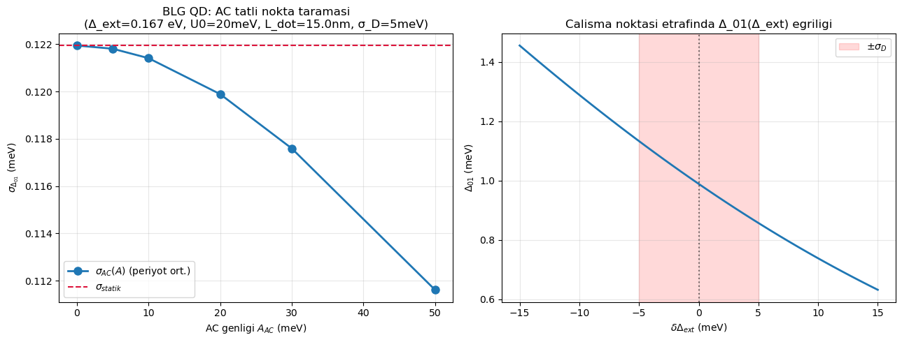
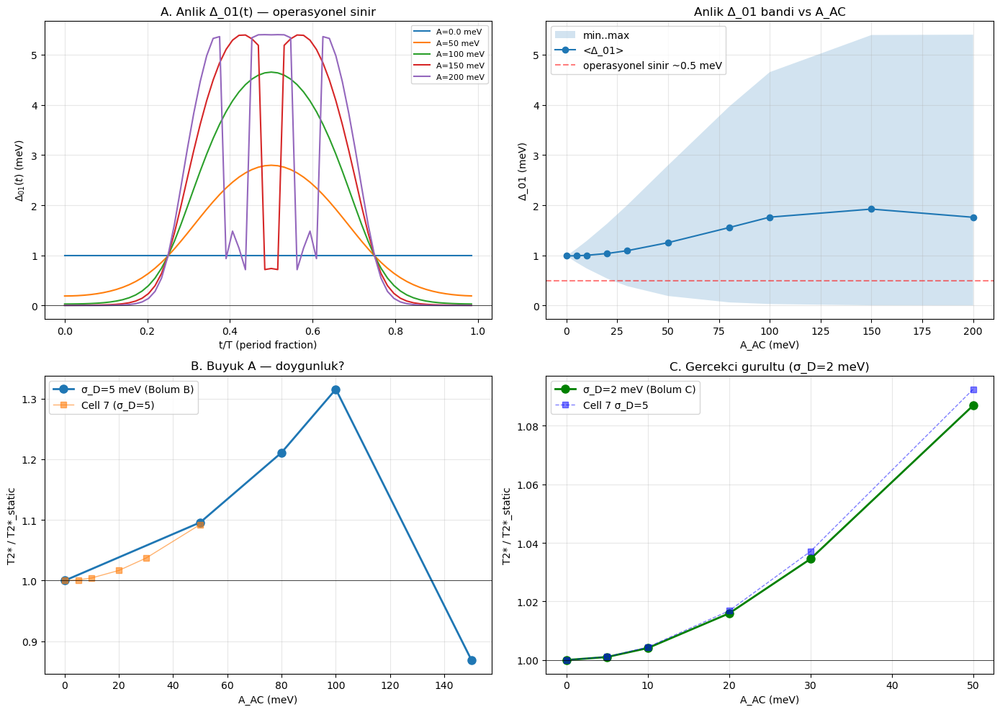
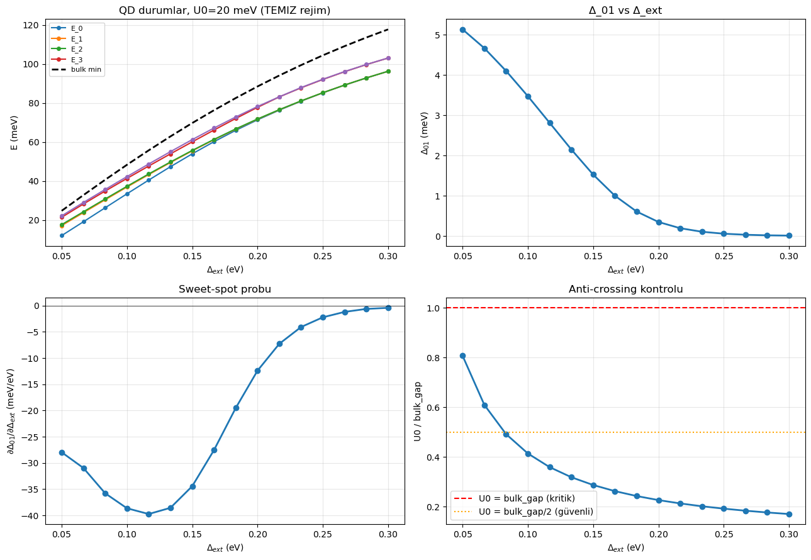
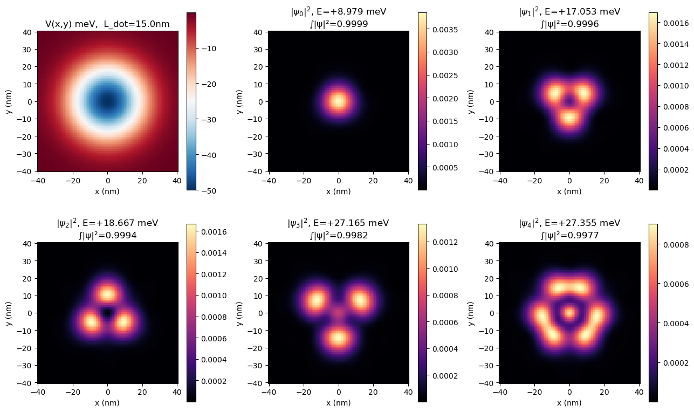

# Charge-noise protection in bilayer-graphene quantum-dot qubits: does AC-modulated confinement help?

**Status:** Manuscript in preparation (unpublished computational study). The central hypothesis was **refuted** by the author's own verification; this repository documents both the original claim and its refutation.

Author: Faruk Sami Bilgin, Independent Researcher (ORCID [0009-0001-9064-4410](https://orcid.org/0009-0001-9064-4410))

## Question

Gate-defined bilayer-graphene (BLG) quantum dots are limited by charge noise. Can an AC (periodically driven) confinement potential protect a BLG dot qubit against charge noise better than static confinement, i.e. create a *dynamical sweet spot* that extends the inhomogeneous dephasing time T2*? And if not, where does charge-noise protection in BLG dots come from at all?

## Method

- **4-band McCann–Koshino k·p continuum model** (basis A1, B1, A2, B2; γ0 = 3.16 eV, γ1 = 0.38 eV, γ3 = 0.38 eV, a = 0.246 nm) in a **plane-wave basis** (L_box = 120 nm, q_max = 0.5 nm⁻¹, N_pw = 293, Hilbert dimension 1172) with a Gaussian dot V(r) = −U0 exp(−r²/2L_dot²). The plane-wave basis replaced an earlier finite-difference discretisation that suffered from fermion doubling (see `notebooks/BLG-AC-analysis.ipynb`).
- **Five structural anchors** (`scripts/blg_kp.py`): Hermiticity, bulk band edge vs. the γ3 = 0 analytic limit, C3 trigonal warping, gapless D = 0 limit, K/K′ time-reversal equality.
- **Period-averaged AC analysis** with a quasi-static Gaussian noise ensemble (`scripts/blg_ac_fast.py`, notebook cells) — the method of the original draft.
- **Full-Hilbert Floquet test** (`scripts/blg_floquet_full.py`): Strang/Trotter time evolution of the two qubit states over one drive period in the complete 1172-dim space, measuring leakage out of the qubit subspace.
- Static sweet-spot scans for single and double dots, box-size convergence tests (`scripts/blg_sweetspot.py`, `blg_doubledot.py`, `blg_dext_scan.py`, `blg_d60*.py`, `blg_converge.py`, `blg_compare.py`), and an orbital-magnetic-moment calculation (`blg_valley.py`, which uses the method later found to be box-divergent).
- An earlier toy tight-binding stage (finite flakes, torus, 1D chain with Crank–Nicolson evolution): `notebooks/toy_model_flake_torus_and_1D_AC.ipynb`.
- An atomistic tight-binding solver in pure NumPy/SciPy compared with the k·p continuum limit (documented in `docs/tr/BLG_Atomistik_TB_Arastirma_Notu.md`; **the solver source is not included in this repository**).

## Key results

### 1. The period-averaging result (original draft) — ~9 % T2* gain
With the period-averaging approximation at the operating point Δ_ext = 0.167 eV, U0 = 20 meV, L_dot = 15 nm (σ_D = 5 meV, 200 noise realisations, 32 phases), T2*(A)/T2*(0) rose monotonically to **1.0926 at A_AC = 50 meV** (1.0870 at σ_D = 2 meV) (`notebooks/BLG-AC-analysis.ipynb`, cells 7–8).




### 2. Refutation
- **Wrong curvature sign.** Δ01(0.150, 0.167, 0.184 eV) = 1.524, 0.989, 0.593 meV gives ∂²Δ01/∂Δ_ext² ≈ +0.48 (**convex**), not concave as the draft's "Jensen" mechanism required.
- **Full Floquet leakage** (ħω = 6.6 Δ01; anchor at A = 0: leakage 9.73e-10 and Floquet splitting 0.98884 meV equal to the static value; nstep = 200/300/500 gives leakage 0.6636/0.6633/0.6632 at A = 30 meV):

| A_AC (meV) | 0 | 5 | 10 | 15 | 20 | 30 | 50 |
|---|---|---|---|---|---|---|---|
| leakage per period | 0.0000 | 0.0286 | 0.1098 | 0.2310 | 0.3755 | 0.6633 | 0.9522 |

At the amplitudes where protection was claimed (A ≳ 20 meV) the drive ejects 38–95 % of the population from the qubit subspace each period, so the period-averaging method is invalid exactly there; where the qubit survives (A ≲ 5 meV) the effect is negligible. **The AC dynamical-sweet-spot hypothesis does not survive.** (Source: `notebooks/birlesimblg.ipynb`, cell 3; `docs/BLG_Charge_Noise_Protection_Report.md`.)

The earlier 1D toy model had already given the opposite sign: T2* ratio 0.946 at the largest drive tested (`notebooks/toy_model_flake_torus_and_1D_AC.ipynb`, last cell).

### 3. Static spectrum and absence of a single-dot sweet spot
Δ01 vs Δ_ext (U0 = 20 meV, L_dot = 15 nm): 5.130, 3.471, 1.524, 0.989, 0.347 meV at Δ_ext = 0.05, 0.10, 0.15, 0.167, 0.20 eV — monotonic, no interior zero of ∂Δ01/∂Δ_ext. A 2D (Δ_ext, U0) scan finds |∂Δ01/∂Δ_ext| only shrinking as Δ01 → 0 (`notebooks/birlesimblg.ipynb`, cell 4). (The early draft's table listed 0.998 meV at 0.167 eV; the re-built solver gives 0.989 meV, which is used here.)




### 4. Structural principle: protection is symmetry-locked
Six candidate "tuned" sweet spots (AC drive, double well at d ≈ 60 nm, valley moment, valley charge sweet spot, two-electron S–T sweet spot, corrected μ_orb extremum) all dissolved under full Floquet or box-size convergence. What survived were exact symmetries: the mirror-symmetric double-well detuning sweet spot (∂Δ01/∂ε = 0 to ~1e-15, but the global D_ext channel stays open), and the first-order charge-noise immunity of a spin qubit within a fixed valley. Intervalley physics (|K−K′| ≈ 17 nm⁻¹) lies outside the envelope model. Details and all numbers: [`docs/BLG_Charge_Noise_Protection_Report.md`](docs/BLG_Charge_Noise_Protection_Report.md).

### 5. Atomistic tight-binding cross-check (from the research note)
The atomistic solver reproduced the k·p dot levels without free parameters: E0 = 60.317 meV vs 60.32 meV (k·p), Δ01 = 0.989 meV vs 0.989 meV. The smooth-potential intervalley matrix element did **not** converge with flake size (ratios 1.05e-01, 4.51e-02, 1.32e-03 at R = 42, 55, 68 nm) and is interpreted as tending to zero — a negative result: no design-dependent intervalley figure. See `docs/tr/BLG_Atomistik_TB_Arastirma_Notu.md` (Turkish).

### Limitations and unfinished parts (stated plainly)
- Spinless envelope k·p with quasi-static Gaussian noise; spin–valley results in the report are phenomenological.
- Several scripts cited in the report (e.g. moment-correction, spin–valley, two-electron, minivalley, atomistic solver) are **not** in this repository because their source files were not available; the corresponding numbers are quoted from the report only.
- `scripts/blg_valley.py` uses the unbounded position operator, which the report later showed to be box-divergent.
- `notebooks/exploratory_tbg/` contains **unfinished** magic-angle twisted-bilayer work: the Bistritzer–MacDonald notebook's Dirac-point anchor at K_M fails (non-zero gap), and `TBG-quantum-sim.ipynb` uses a phenomenological flat-band model with hand-set parameters. No results from these notebooks are claimed.

## How the results were verified
Every quantitative claim was tied to an explicit anchor: structural identities (Hermiticity, K/K′ equality, A = 0 Floquet ≡ static), analytic limits (γ3 = 0 band edge, D = 0 gaplessness), time-step and box-size convergence, independent re-implementation (the solver was rebuilt from scratch and reproduced the draft's Δ01 table), and an independent atomistic method agreeing with k·p to three digits. Claims that failed an anchor are reported as negative results.

## Reproducing
```bash
pip install -r requirements.txt
cd scripts
python blg_kp.py            # five structural anchors (~1 min)
python blg_dot.py           # Delta01 vs Delta_ext table + curvature
python blg_floquet_full.py  # full-Hilbert Floquet leakage
python blg_sweetspot.py     # 2D (Delta_ext, U0) sweet-spot scan
bash run_all.sh             # all scripts, logs to results/logs/
```
Re-runs made while preparing this repository (2026-11-15, Python 3.13.3, numpy 2.2.5, scipy 1.18.0) are in `results/logs/`: `blg_kp.txt` (all five anchors pass; Hermiticity and K/K′ differences 0.00e+00; dominant angular harmonic m = 3) and `blg_dot.txt` (reproduces the Δ01 table above and ∂²Δ01/∂Δ_ext² ≈ 0.4830, convex). The Floquet and scan scripts were not re-run for lack of time; their numbers above come from the saved notebook outputs.

## Repository layout
`scripts/` solver and analysis scripts · `notebooks/` original notebooks with outputs · `figures/history/` figures saved by the notebooks (Turkish labels) · `docs/` reports converted from Word (`docs/tr/` Turkish) · `paper/ABSTRACT.md` extended abstract.

## Related work by the author
- Twisted hBN preprint: https://doi.org/10.5281/zenodo.24201814
- Twisted MoS2 preprint: https://www.alphaxiv.org/abs/2611.twisted-mos2-hole-spin-coherence
- Moiré microwave loss: https://doi.org/10.5281/zenodo.24204124
- josim-cpr-bridge: https://github.com/FarukSamiBilgin/josim-cpr-bridge

## Citation
```bibtex
@misc{bilgin_blg_qd_qubit,
  author = {Bilgin, Faruk Sami},
  title  = {Charge-noise protection in bilayer-graphene quantum-dot qubits: a refuted AC dynamical-sweet-spot hypothesis},
  year   = {2026},
  note   = {Manuscript in preparation},
  url    = {https://github.com/FarukSamiBilgin/bilayer-graphene-qd-qubit}
}
```

AI assistance: AI coding assistants were used for code development and for adversarial review. Load-bearing results are checked against built-in analytic anchors (there is no separate automated test suite); the author is responsible for every claim.

## License
Code: MIT (`LICENSE`). Text, figures and data: CC BY 4.0 (`LICENSE-CONTENT`).
